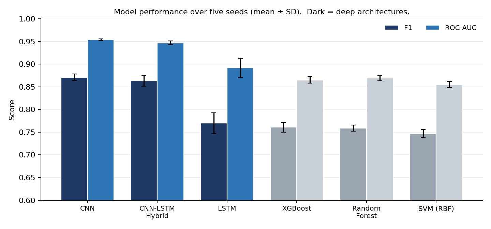
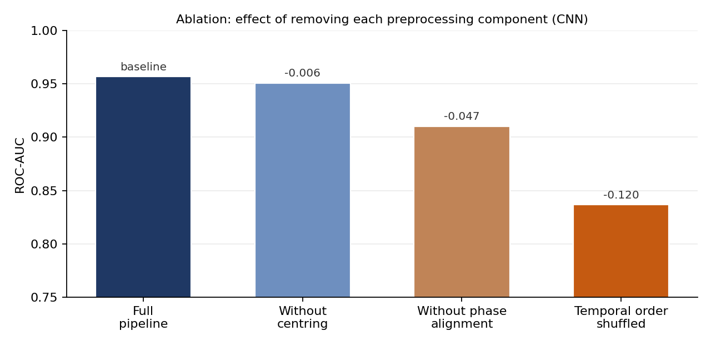
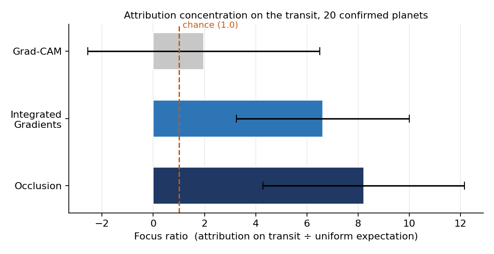

# Exoplanet Transit Detection from Stellar Light Curves

**A controlled comparison of classical machine learning and deep learning for automated transit vetting.**

When a planet passes in front of its host star it blocks roughly 1% of the light, and does so once per orbit. Surveys like Kepler record that signal for hundreds of thousands of stars, producing far more candidate detections than anyone can inspect by hand — and most of them are false alarms from eclipsing binaries, stellar variability or instrument artefacts. The bottleneck is no longer detection; it is triage.

This project asks which family of models does that triage best, and — more unusually — whether the differences between them are real.

> MSc Artificial Intelligence dissertation, Ulster University (2026). Awarded a Distinction.

---

## Headline results

Seven models, identical preprocessing and splits, every figure averaged over five random seeds.

| Model | Accuracy | Precision | Recall | F1 | ROC-AUC |
|---|---|---|---|---|---|
| **1D CNN** | **0.891** ± .006 | 0.852 ± .011 | 0.891 ± .016 | **0.871** ± .007 | **0.954** ± .002 |
| CNN-LSTM hybrid | 0.885 ± .009 | 0.847 ± .016 | 0.881 ± .029 | 0.863 ± .012 | 0.947 ± .004 |
| Dual-view CNN¹ | 0.883 ± .003 | 0.842 ± .013 | 0.883 ± .023 | 0.862 ± .005 | 0.951 ± .005 |
| LSTM | 0.805 ± .017 | 0.752 ± .038 | 0.795 ± .064 | 0.770 ± .023 | 0.892 ± .021 |
| XGBoost | 0.790 ± .010 | 0.718 ± .014 | 0.811 ± .021 | 0.761 ± .011 | 0.865 ± .007 |
| Random Forest | 0.798 ± .003 | 0.748 ± .006 | 0.771 ± .020 | 0.759 ± .007 | 0.869 ± .006 |
| SVM (RBF) | 0.777 ± .005 | 0.704 ± .004 | 0.795 ± .022 | 0.747 ± .009 | 0.855 ± .007 |

¹ 5,300 paired curves rather than 5,302 — see *Data alignment* below.

Every deep architecture separates from every classical baseline, confirmed by McNemar's test and bootstrap confidence intervals on the AUC difference. The dataset authors reported **82.92%** accuracy with LightGBM on this same corpus; the CNN reaches **89.1% ± 0.6%** (different train/test split, so indicative rather than a controlled replication).



---

## What makes this more than a model bake-off

**Single runs prove nothing.** Run-to-run variance here is around ±0.005 AUC — larger than the gap between the top two models. Every result is therefore reported as mean ± standard deviation over five fixed seeds, and differences are tested rather than asserted.

**Two significance tests, one informative disagreement.** Comparing the CNN against the hybrid, McNemar's test returns *p* = 0.49 — at the decision threshold they classify the same objects identically. But the bootstrap interval on their AUC difference is [0.003, 0.018], excluding zero. The models agree on *which* candidates are planets while differing slightly in the confidence ordering they impose. No single accuracy figure exposes that.

**Ablation shows what the result actually rests on.** Each preprocessing component was removed in turn:

| Component removed | ROC-AUC | Δ |
|---|---|---|
| — (full pipeline) | 0.957 | — |
| Baseline centring | 0.951 | −0.006 |
| Phase alignment | 0.910 | −0.047 |
| Temporal ordering | 0.837 | **−0.120** |

Permuting flux values within a curve leaves every summary statistic unchanged — mean, variance, minimum, every percentile — and still costs 0.120 AUC. That number is a direct measurement of how much information lives in the *ordering* rather than the values, and it is the clearest argument for why convolution suits this problem.



**Three attribution methods, not one saliency plot.** Attribution concentration on the transit window, relative to what a uniform distribution would place there (1.0 = chance):

| Method | Focus ratio | SD |
|---|---|---|
| Occlusion | 8.22 | 3.94 |
| Integrated Gradients | 6.63 | 3.38 |
| Grad-CAM | 1.97 | 4.53 |

Two methods place 6–8× more attribution on the transit than chance. Independently, permutation importance on the *classical* models ranks a noise-robust depth measure first and the phase position of the deepest point second. Two unrelated routes converging on the same physics is stronger evidence than either alone.



---

## Two negative results, reported as such

**The dual-view architecture did not help.** Fusing a zoomed local view with the global view is the design from Shallue & Vanderburg (2018), and it was expected to improve things. It scored marginally *lower* (F1 0.862 vs 0.871), within one to two standard deviations. This is dataset-specific rather than a refutation — their corpus was roughly three times larger with a different windowing scheme — and the plausible reading is that at 2,001 bins the global view already resolves the transit adequately here.

**Grad-CAM proved unreliable on this signal.** Standard Grad-CAM applies a rectifier to retain positive evidence, an assumption inherited from image classification. A transit is a *downward* excursion, so the activation map came out entirely negative and the ReLU zeroed it. The implementation detects single-polarity maps and takes the magnitude of the deviation instead — and even after that correction, the focus ratio's standard deviation exceeds its mean.

---

## Data

[Macedo & Zalewski (2024)](https://doi.org/10.17632/wctcv34962.3), Mendeley Data — 5,302 phase-folded Kepler light curves derived from Kepler Objects of Interest in the NASA Exoplanet Archive. PDCSAP flux extracted with Lightkurve, normalised, gap-interpolated and 2σ outlier-cleaned by the dataset authors.

The data is **not bundled** in this repository. Download it from the DOI above and place `all_global.csv` and `all_local.csv` in `data/`.

Labels come from the KOI disposition, with `CONFIRMED` as the positive class. Class balance is **41.4% / 58.6%** — far more even than the full stellar catalogue, so class weighting is retained in the pipeline but has limited effect.

### Data alignment — read this before pairing the two views

`all_global.csv` has 5,302 rows; `all_local.csv` has 5,300. The difference is **not** a trailing truncation: the global file carries one surplus record at index 3088 and one at the end.

Pairing the files by position would attach the wrong local view to roughly **42% of the dataset**, and nothing in the training curves would reveal it. The offset was located by comparing label sequences; the corrected pairing gives 100% label agreement against ~52% under random pairing. `src/dual_view.py` applies the correction and asserts it before returning, so the failure cannot happen silently.

---

## Repository layout

```
src/
  config.py            Central configuration, seeding, reproducibility
  preprocessing.py     Cleaning, phase-folding, baseline centring
  data_loader.py       Dataset loading and class-balance audit
  dual_view.py         Global/local alignment + two-branch architecture
  classical_models.py  Random Forest, SVM, XGBoost
  deep_models.py       1D CNN, LSTM, CNN-LSTM hybrid
  statistics.py        McNemar, bootstrap CIs, multi-seed aggregation
  ablation.py          Preprocessing ablation framework
  explainability.py    Integrated Gradients, Grad-CAM (1D), occlusion, focus ratio
  calibration.py       Reliability, ECE, Brier, threshold optimisation
  error_analysis.py    Failure profiling, complementarity, oracle ceiling
  evaluation.py        Shared metrics and plots
tests/                 17 unit tests covering the analysis machinery
notebooks/             End-to-end study (GPU)
figures/ results/      Generated outputs
```

## Running it

```bash
pip install -r requirements.txt
python tests/test_pipeline.py        # 17 passed
```

Then run `notebooks/Exoplanet_Full_Study.ipynb` on a GPU runtime with the data in place. Seeds and hyperparameters live in `src/config.py`.

---

## Implementation notes

**LSTM training stability.** At a 1e-3 learning rate without gradient clipping the LSTM suffered exploding gradients and collapsed to chance by the third epoch. It is trained at 3e-4 with `clipnorm=1.0`, so the comparison reflects the architecture rather than a training failure. It remains the highest-variance model in the study (±0.064 on recall).

**Baseline centring.** A folded curve sits near 1.0 with a transit depth around 0.01, so the signal is a small perturbation on a large constant. Subtracting the per-row median moves the baseline to zero. Early deep models sat at chance until this was added — its contribution is to optimisation rather than to the information available, which is exactly what the ablation shows.

**Global max pooling in the dual-view branches.** A transit is a localised extremum; average pooling dilutes it.

## Limitations

- All evidence comes from a single mission and a pre-vetted candidate set, so results describe classification *within a filtered list* rather than detection from raw photometry. Validation on TESS would test this directly.
- The classical models receive six engineered descriptors while the deep models receive the full sequence, so the comparison measures representations as much as algorithms.
- Five seeds is enough to expose the LSTM's instability but not to characterise it precisely.

## References

1. C. J. Shallue and A. Vanderburg, "Identifying Exoplanets with Deep Learning," *The Astronomical Journal*, 155(2), art. 94, 2018. [doi:10.3847/1538-3881/aa9e09](https://doi.org/10.3847/1538-3881/aa9e09)
2. M. Ansdell et al., "Scientific Domain Knowledge Improves Exoplanet Transit Classification with Deep Learning," *ApJL*, 869(1), art. L7, 2018. [doi:10.3847/2041-8213/aaf23b](https://doi.org/10.3847/2041-8213/aaf23b)
3. H. Valizadegan et al., "ExoMiner++: Enhanced Transit Classification and a New Vetting Catalog for 2-Minute TESS Data," *The Astronomical Journal*, 170(5), art. 287, 2025. [doi:10.3847/1538-3881/ae03a4](https://doi.org/10.3847/1538-3881/ae03a4)
4. B. H. D. Macedo and W. Zalewski, "Automated Light Curve Processing for Exoplanet Detection Using Machine Learning Algorithms," *Rev. Bras. de Iniciação Científica*, 11, art. e024021, 2024.
5. B. H. D. Macedo and W. Zalewski, "Dataset_Machine_Learning_Exoplanets_2024," Mendeley Data v3, 2024. [doi:10.17632/wctcv34962.3](https://doi.org/10.17632/wctcv34962.3)

## Licence

Code released under the MIT Licence — see [LICENSE](LICENSE). The underlying dataset belongs to its authors and is cited above, not redistributed here.
